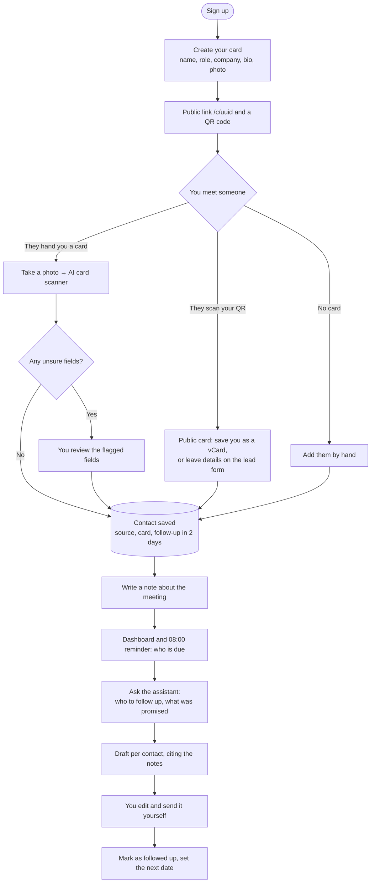
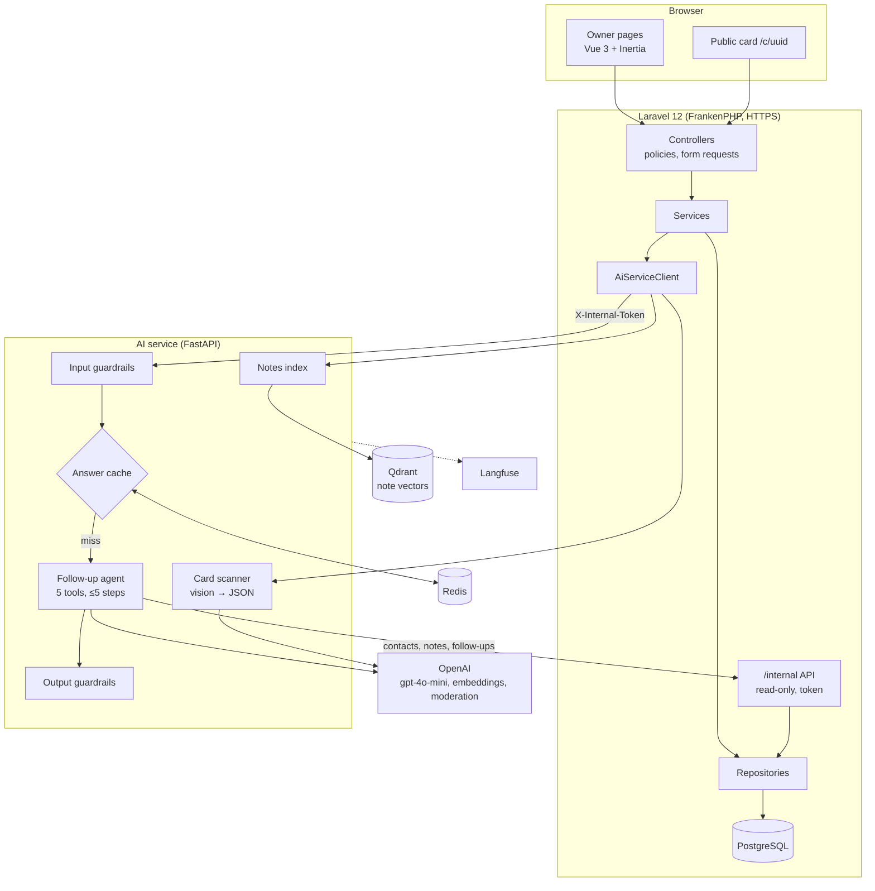
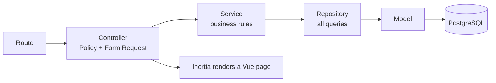
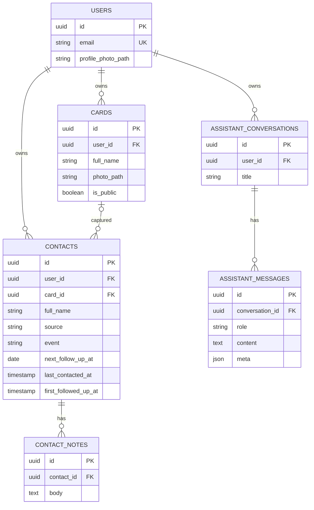

# MetMemo architecture

How MetMemo works and how it is built, as deployed on 2026-10-31. This replaces the proposal-stage
[MetMemo-Architecture.pdf](MetMemo-Architecture.pdf), which still shows integer ids and the AI features as "to build".

**Met** is the people you meet: your card, its QR code, the lead form, and the paper cards you scan.
**Memo** is the memory of each meeting: your notes, follow-up dates, and the assistant that recalls them and drafts
your follow-up. The AI only suggests and drafts. You decide and you send.

## 1. The workflow



## 2. System

Two applications. Laravel owns the users, the data and every page. The Python AI service owns every model call.
Laravel never calls OpenAI directly: it calls the AI service over HTTP with a shared `X-Internal-Token`, and the
assistant's tools read contacts back through Laravel's read-only `/internal` API with the same token. Ownership
rules therefore stay in one place (Laravel), and the model never chooses whose data to read: `user_id` is fixed
per request.



| Part | Technology | Job |
|---|---|---|
| Web app | Laravel 12, Jetstream, Inertia, Vue 3, Tailwind | Login and 2FA, cards, contacts, notes, dashboard, insights, exports, public card, QR and vCard, the Assistant page |
| Database | PostgreSQL 17 | All app data, UUID keys; every card, contact and chat belongs to one user |
| AI service | FastAPI, Pydantic | The only place that talks to a model; validates every request, tool argument and response |
| LLM | OpenAI `gpt-4o-mini`, temperature 0 | Plans, chooses tools, reads card photos, drafts messages |
| Embeddings | `text-embedding-3-small` (1536 dims) | Turns `"{contact name}: {note}"` into a vector (the name fixes failure F1) |
| Vector store | Qdrant 1.19, collection `contact-notes` | Finds the notes that match a question, always filtered by `user_id` |
| Cache | Redis 7 | Embeddings (30 days, content-addressed) and repeated answers (10 minutes, invalidated by any note change) |
| Guardrails | Regex + OpenAI moderation + PII masking + citation checks | See [guardrails.md](evidence/guardrails.md) |
| Tracing | Langfuse | Every request's tool calls, retrieved notes, latency, tokens and eval scores |
| Deployment | Docker Compose on a DigitalOcean droplet | FrankenPHP serves HTTPS itself; only ports 80 and 443 are public ([deploy/README.md](../deploy/README.md)) |

## 3. Inside Laravel

Every request goes down the same layers. Each has one job, which keeps the code testable.



| Layer | Folder | Examples |
|---|---|---|
| Controller | `app/Http/Controllers` | Card, Contact, ContactNote, Scan, Assistant, Dashboard, Insights, ContactExport, PublicCard, `Internal/*` |
| Policy | `app/Policies` | You can only touch your own records |
| Service | `app/Services` | CardService, ContactService (lead capture, due list), VCardService, ContactExportService, InsightsService, `Ai/AiServiceClient`, `Ai/NotesIndexer` |
| Repository | `app/Repositories` | Interfaces in `Contracts`, Eloquent versions bound in `RepositoryServiceProvider` |
| Model | `app/Models` | User, Card, Contact, ContactNote, AssistantConversation, AssistantMessage |
| Pages | `resources/js/Pages` | Dashboard, Cards, Contacts, Scan, Assistant, Insights, Public, Profile, Welcome |

## 4. One assistant request

The assistant doesn't answer in one shot. It calls tools for real data, searches the notes, and only then answers
or drafts. Guardrails check what goes in, what the tools return, and what comes out.

```mermaid
sequenceDiagram
    actor U as You
    participant L as Laravel
    participant A as AI service
    participant G as Guardrails
    participant R as Redis
    participant M as gpt-4o-mini
    participant T as Tools (Laravel /internal, Qdrant)
    U->>L: "What did I promise Elena Castillo?"
    L->>A: POST /assistant/chat (user_id, message, history)
    A->>G: injection, bulk data, moderation, PII
    G-->>A: safe (or refuse: 0 model calls)
    A->>R: answer cache lookup
    R-->>A: miss
    A->>M: system prompt "grounded" + tools
    M-->>A: find_contact("Elena Castillo")
    A->>T: contact search (scoped to user_id)
    M-->>A: get_contact_notes(...)
    A->>T: notes → masked, labelled as data, refs N1…
    M-->>A: answer citing [N1]
    A->>G: moderation, PII, citations point at real notes
    A->>R: store answer (10 min)
    A-->>L: answer, sources, drafts, tool calls
    L-->>U: answer with citation chips; chat saved
```

| Spec item | How MetMemo covers it |
|---|---|
| Tool calling | `get_overdue_followups`, `find_contact`, `get_contact_notes`, `search_notes`, `draft_followup_message` |
| Multi-step planning | Find who is due, read their notes, then draft, in one request (at most 5 steps) |
| RAG | `search_notes`: semantic search over your own notes in Qdrant, filtered to your user id |
| Memory | Chats are saved; the history is sent with each message |
| Structured output | Pydantic everywhere; the scanner returns each field with confidence and a needs-review flag |
| Human in the loop | Scanned fields are confirmed by you; drafts are never sent |
| Graceful failure | Tool errors are reported plainly; if the AI service is down, the rest of the app keeps working |
| Prompt variants | `baseline`, `structured`, `grounded`, compared on the same cases ([prompt-decision.md](evidence/prompt-decision.md)) |

## 5. Database



| Table | What it holds | Notes |
|---|---|---|
| `users` | Accounts | Jetstream login, two-factor auth, passkeys, profile photo |
| `cards` | Your digital business cards | The UUID is the public link (unguessable); `is_public` turns it off |
| `contacts` | Everyone you met | `source` is manual, lead_form or scan; index on (`user_id`, `next_follow_up_at`) for the due list |
| `contact_notes` | What you talked about | The text the assistant reads and searches |
| `assistant_conversations`, `assistant_messages` | Saved chats | `meta` holds the cited notes, drafts and tool calls of each answer |
| Qdrant `contact-notes` | One vector per note | Payload: `user_id`, `contact_id`, `note_id`, contact name, body; every search is filtered by `user_id` |
| Redis | Cache only | Nothing that can't be rebuilt; losing it only costs speed |

## 6. Build status

| Feature | Status | Evidence |
|---|---|---|
| Accounts, cards, public page, QR, vCard, lead form | Built | Feature tests |
| Contacts, notes, dashboard, reminders, insights, exports | Built | Feature tests |
| Card scanner | Built | `ai-service/tests/test_scanner.py` |
| Follow-up assistant (tools, RAG, memory, saved chats) | Built | [prompt-decision.md](evidence/prompt-decision.md) |
| Guardrails | Built | [guardrails.md](evidence/guardrails.md) |
| Caching | Built | [caching.md](evidence/caching.md) |
| Tracing | Built | Langfuse, every request and eval case |
| Evaluation and improvement iteration | Built | [evaluation.md](evidence/evaluation.md), [failure-log.md](evidence/failure-log.md) |
| Deployment | Live | https://metmemo.app, [deploy/README.md](../deploy/README.md) |
